<p align="center">
  
</p>

<p align="center">
  <a href="mailto:tienphamvan2005@gmail.com"></a>
  <a href="https://www.facebook.com/profile.pvt.111"></a>
  <a href="https://www.instagram.com/phamtien1910"></a>
</p>

## 🕹️ Player

```yaml
class:    Software Engineer @ D-Soft
main:     NestJS · ASP.NET Core · React
build:    Clean Architecture + DDD
passive:  AI-assisted engineering (Claude Code, LangGraph)
```

## ⚔️ Bosses

<p align="center">
  
</p>

## 🎒 Inventory

<p align="center">
  
</p>
<p align="center">
  
  
  
  
  
</p>

## 🏆 Scoreboard

<p align="center">
  
  
</p>
<p align="center">
  
</p>

<p align="center">
  <picture>
    <source media="(prefers-color-scheme: dark)" srcset="https://raw.githubusercontent.com/PhamVanTien1910/PhamVanTien1910/output/github-snake-dark.svg" />
    
  </picture>
</p>

<p align="center"><code>GAME OVER? ▶ CONTINUE (Y/N)</code></p>
